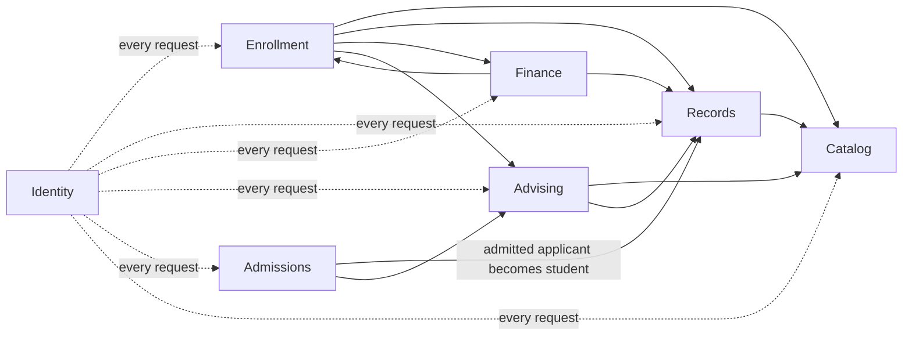

# Domains

The system is split into eight domains. Each domain is owned by two teams,
and each team owns one **slice** of the domain so the two can work in
parallel. Both teams co-own the domain's contract (`src/contract.rs`): the
types and API shapes other domains and clients depend on.

| Domain | Crate | Slice 1 | Slice 2 | Doc |
| --- | --- | --- | --- | --- |
| Platform | `sis-core`, `sis-api` | Core and API server | Client shells and shared UI | [platform.md](platform.md) |
| Identity | `sis-identity` | Accounts and roles | Authentication and sessions | [identity.md](identity.md) |
| Catalog | `sis-catalog` | Courses | Terms and sections | [catalog.md](catalog.md) |
| Enrollment | `sis-enrollment` | Registration | Waitlists and rosters | [enrollment.md](enrollment.md) |
| Records | `sis-records` | Student profiles | Grades and transcripts | [records.md](records.md) |
| Finance | `sis-finance` | Billing and payments | Holds and financial aid | [finance.md](finance.md) |
| Advising | `sis-advising` | Programs and requirements | Degree audit and advisor tools | [advising.md](advising.md) |
| Admissions | `sis-admissions` | Applications | Review and decisions | [admissions.md](admissions.md) |

## How the domains depend on each other

Read an arrow as "depends on". Enrollment has the most upstream
dependencies, so its neighbors should publish contracts and mock data early.
Until a neighbor's real endpoint exists, build against a mock that matches
its contract.

## How to read each domain doc

Each doc covers:

- **Purpose:** what the domain is responsible for, and what it is not.
- **Slices:** how the two owning teams divide the work.
- **Core concepts:** the main entities. These are starting points, not final schemas.
- **Features:** grouped into **Foundation** (needed for the system to work
  end to end), **Core** (expected of a real SIS), and **Stretch** (if time allows).
- **Business rules:** constraints the code must enforce.
- **Interactions:** what the domain needs from others, and what it provides.
- **Open questions:** decisions the owning teams need to make and record as ADRs.

Feature lists describe *what* the domain must support, not *how*. Endpoint
paths, field names, and storage design are for the owning teams to decide.
